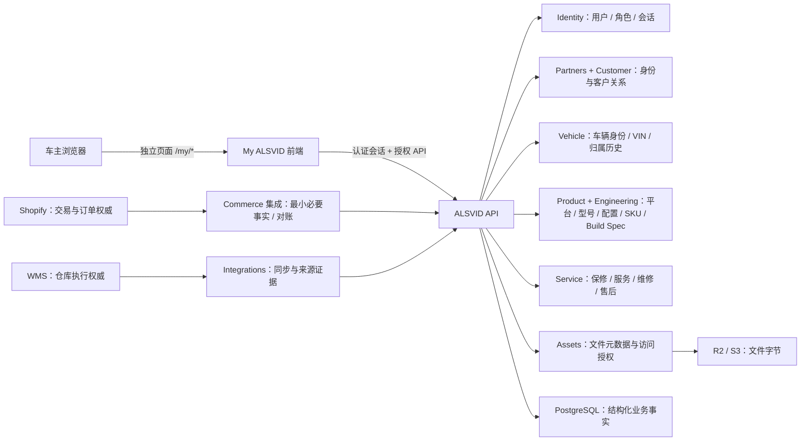

# My ALSVID 车主中心（我的车库）产品与技术架构

> 状态：V1 需求基线，待产品负责人逐项验收；本文件描述目标与当前证据，不代表未实现功能已上线。
> 适用项目：My ALSVID（独立车主前端），当前代码入口位于 `apps/web/app/my`。
> 最后整理：2026-10-16
> Figma：[ALSVID My ALSVID 车主车库 V1](https://www.figma.com/design/LuoLxuaizvjNMPbAhubd8i)

## 1. 目标与边界

My ALSVID 是以车主名下车辆为中心的生命周期空间。用户登录后首先看到自己的车，而不是订单金额、会员积分或企业运营指标。

```text
车主身份
  → 当前车辆归属
  → VIN / Frame Number
  → 车型与实际生产规格
  → 购买与交付凭证
  → 保修
  → 服务与维修
  → 售后申请
  → 车辆文件与兼容配件
```

My ALSVID 是 ALSVID 四个独立前端项目之一：ALSVID Official、My ALSVID、ALSVID Dealer Portal、ALSVID Admin。它不是商城账户页，不是 Admin/Dealer 的一个菜单，不是 ERP、OMS、WMS、普通 CRM 或数据大屏。项目可以共享 monorepo、统一身份、API 和设计基础，但必须保留自己的入口、路由、用户体验与权限边界。商城入口只负责跳转；车主中心与商城交易、Admin 工作台保持产品和页面分离。

**不在 V1 范围内：** 重建 Shopify 结账/支付/订单编排、复制 WMS 库存台账、开放 Admin/经销商运营数据、前端自判车辆归属、独立维护第二份车辆数据库、营销会员积分体系、未经确认的自动通知或车辆自动轮播。

## 2. 核心架构约束

ALSVID 按现有模块化单体和统一 API 实施；My ALSVID 是独立前端体验，不意味着另建后端、数据库或微服务。



### 2.1 权威数据归属

| 事实 | 唯一写入权威 | My ALSVID 可以做什么 |
| --- | --- | --- |
| 用户、登录会话、角色与授权 | Identity | Shopify Customer 账户验证后建立 ALSVID 最小身份映射；每次请求仍由服务端鉴权 |
| 法人/个人身份主记录 | Partners | 读取获授权的本人资料；客户专属状态由 Customer 管理 |
| 产品平台、型号、Variant、SKU | Product | 展示车辆关联的产品身份 |
| BOM Revision、Build Specification | Engineering | 展示车辆实际采用的已发布规格摘要 |
| 物理车辆、VIN、Frame Number、车辆生命周期 | Vehicle | 读取本人的车辆视图；不能自行创建或改写生产事实 |
| 车辆所有权历史 | Vehicle | 仅查询当前用户有权看到的有效所有权期间 |
| Shopify 订单/付款/商城交易 | Shopify；ALSVID Commerce 维护必要映射与同步证据 | 展示经授权的购买凭证摘要；不在 ALSVID 改单、收款或替代 Shopify |
| 仓库收发、拣货、打包、出库事实 | WMS | 展示交付所需的最小状态，不成为仓库操作入口 |
| 保修、服务预约/记录、维修、售后案例 | Service | 按车主和车辆权限读取；允许建立受控的车主服务请求 |
| 文件关系、访问策略与元数据 | Assets | 展示授权文件；实际二进制存储在 R2/S3 |
| 外部同步游标、Webhook 接收证据 | Integrations | 不直接修改；页面显示来源和更新时间 |
| 安全/业务审计证据 | Audit | 用户端不可修改或删除 |

具体领域权威以 [数据权威](https://github.com/jinfenghua1990/ALSVID/blob/main/docs/DATA_OWNERSHIP.md) 为准。跨领域写操作经公开 application contract 或事件，不直接改其他领域的数据表；前端不得连接 PostgreSQL 或对象存储。

### 2.2 外部事实与新鲜度

- Shopify 负责商城商品交易、订单和付款；My ALSVID 只呈现车主需要的已归一化购买事实。
- WMS 负责仓库执行；ALSVID 不复制完整仓库数据库或库存账本。
- 对外部系统缓存的数据保存来源引用、同步状态和最后成功更新时间。按现行架构默认至少每日同步/对账；如果页面数据可能滞后，展示更新时间和刷新预期，可提供受控的“刷新最新状态”。实时 Webhook 是有业务证据后的优化，不是 V1 前置条件。
- 文件内容放在 R2/S3；PostgreSQL 保存对象引用、归属关系、校验和、可见性与生命周期状态。下载必须先授权，再签发短期访问地址。

## 3. 用户、授权与隐私

| 使用者 | 可见范围 |
| --- | --- |
| 普通车主 / 认证车主 | 当前账号经服务端确认归属的车辆、必要购买摘要、保修、服务/维修、本人售后和车辆文件 |
| 企业/车队客户成员 | 仅授权组织及明确分配的车辆；需经过组织角色和车辆范围检查 |
| 经销商人员 | 仅授权经销商、服务职责和分配范围；不得通过 My ALSVID 客户端查看其他车主资料 |
| Admin 员工 | 仅在 Admin 项目按员工角色授权后访问运营数据；员工身份不自动授予车主或经销商身份 |

My ALSVID 使用 Shopify Customer 账户作为客户身份来源：客户先在 Shopify 完成账户验证，再通过受控回调/令牌交换确认 Shopify customer 标识，由 ALSVID 建立最小身份映射。My ALSVID 不自行创建客户账号，也不允许仅凭一个邮箱注册。登录成功不等于拥有车辆，车辆可见范围仍由 Vehicle 所有权/授权关系决定。详见 [门户登录与会话规则](https://github.com/jinfenghua1990/ALSVID/blob/main/docs/PORTAL_LOGIN_RULES.md)。

强制规则：

1. 服务端从已验证会话取得用户/组织身份；每次车辆详情、VIN 查询、文件下载、售后读取/创建都校验主体与目标 Vehicle 的权限。
2. 不能依赖隐藏按钮、路由名、客户端状态或 `localStorage` 控权；更换 URL 中的 `vehicleId` 不得扩大访问范围。
3. VIN 在未完成归属验证前不得用于枚举车辆或返回完整车辆信息。列表/非必要区域遮蔽 VIN；绑定结果不向未授权主体泄露车辆是否存在、完整车主或订单资料。
4. 车辆转让追加所有权历史，不覆盖旧记录。前车主不得因此继续读取当前车主的联系方式、售后、文件或车辆私密数据。
5. 售后请求绑定当前认证用户、授权车辆和审计事件；客户端提交的 customer/owner ID 不作为权威字段。
6. 上传与附件检查文件类型、大小和访问范围；私有照片和维修报告不生成公开永久链接。
7. 开发 fixture 必须显著标记为预览数据，不混入生产，不伪装成真实客户、订单、保修或服务记录。

## 4. 页面与独立画板清单

每个可单独评审的路由对应一个独立页面/画板。Figma Starter 当前最多 3 个 Figma Pages，因此文件用 3 个分类 Page 容纳多个**互不嵌套、单独命名的画板**；这些画板不是一张拼接的页面，也不能把商城首页或 Admin 工作台放进车主文件。

| 页面/画板 | 路由目标 | 页面责任与主要内容 |
| --- | --- | --- |
| 车主首页 / 我的车库 | `/my` | 欢迎语、车辆视觉、当前车辆身份、保修/最近服务、快捷入口、多车切换 |
| 我的车辆 | `/my/vehicles` | 车主拥有的车辆卡片、车型/VIN/车架号/购买日/保修与服务状态、查看详情、添加车辆 |
| 绑定车辆 | `/my/vehicles/register` | VIN + Frame Number 验证、服务端匹配、确认车型/图片/购买摘要、绑定或明确错误 |
| 车辆概览 | `/my/vehicles/[vehicleId]` | 单车身份、配置、颜色、生产/购买/交付摘要、来源与状态 |
| 购买记录 | `/my/purchases`（或从车辆详情进入） | 本人订单摘要、车型/SKU、购买/交付事实和外部订单引用；不提供 OMS 改单/收款操作 |
| 保修详情 | `/my/vehicles/[vehicleId]/warranty` | 整车及部件保障、起止日、剩余时间、有效/即将到期/过期/暂停/待确认状态 |
| 服务记录 | `/my/vehicles/[vehicleId]/service` | 独立的服务时间线；日期、经销商/地点、项目、配件、人员、附件和状态 |
| 维修记录 | `/my/vehicles/[vehicleId]/repairs` | 独立的维修记录；问题、类型、处理地点、状态、日期、更换件和结果 |
| 我的服务 | `/my/service` | 车主可跟进的服务和售后请求列表/状态；与车辆上下文相连 |
| 新建售后申请 | `/my/service/new` | 车辆、问题类型、描述、附件、联系方式、编号、状态、响应预期；从车辆入口用查询参数预选 |
| 车辆文件 | `/my/vehicles/[vehicleId]/manual` | 当前车辆可访问的手册、维护、安全、保修、交付、发票和报告；后续是否统一命名为 `/documents` 需单独评审 |
| 兼容配件 | `/my/vehicles/[vehicleId]/accessories` | 按型号、Variant、年份和兼容规则筛选的配件；后续链接 Shopify，不在此复制商品/库存权威 |
| 我的账户 | `/my/account` | 本人姓名、邮箱、手机、语言、通知、隐私、安全和退出登录；无积分/电商等级 |

**Figma 文件当前状态（2026-10-16）：** 独立文件已创建，包含车主首页、车辆列表、车辆概览、保修、服务记录、维修记录、售后申请、VIN 绑定、账户，以及一个把车辆文件与配件放在一起的画板。最后这个画板尚未按本规范拆成两个独立页面，不能视为已验收。由于 Starter MCP 操作额度用尽，分拆和最终走查待续；不得把未验收画板当作完成设计。

## 5. 关键页面规格

### 5.1 一级导航与视觉

顶部品牌为 `ALSVID / My ALSVID`，车主导航为首页、我的车辆、服务、我的账户。`官方首页 ↗` 使用统一 portal routing 生成网址，并以新标签打开（`target="_blank"`、`rel="noopener noreferrer"`），不打断车库状态。账户与主题入口保持轻量。

品牌视觉沿用 ALSVID Official 的留白、浅色背景、深色文字、细线、轻量圆角与产品摄影。车辆是视觉中心。参考 Apple ID、Tesla Garage、Shopify Account 仅用于交互节奏，不复制其品牌资产。移动端为单列卡片，触控区易操作，无横向溢出。禁止后台侧栏、密集表格、重渐变、KPI 堆叠和促销弹窗。

### 5.2 车库与多车切换

- 车主首页显示“我的车辆 · 共 N 辆”，优先展示当前车辆，不以订单金额作为首屏信息。
- 多车桌面端：左右箭头、当前序号、分页点、查看全部车辆、键盘左右键；移动端：手势滑动和清晰提示。不得自动轮播。
- 切换时车辆图片、型号/配置、脱敏 VIN、Frame Number、购买日、保修、最近服务、维修/售后入口、文件、配件、详情路由一起切换。
- 只有一辆车时隐藏箭头、圆点、序号和滑动提示；没有车时显示明确的绑定车辆空状态。
- 最近选择只作为体验偏好，按账号隔离保存（例如 `alsvid:garage:vehicle:<userId>`）；会话丢失、存储不可用或 ID 无效时回退到服务端提供的首辆可访问车辆。
- 通知必须指向具体车辆与事件，如“FC1 Pro 保修将在 30 天后到期”；仅对到期、待处理售后、预约、安全和绑定等重要事项展示，不强制弹窗。

### 5.3 车辆列表与绑定

车辆卡片显示车型/图片、脱敏 VIN、Frame Number、购买日期、保修状态、服务状态及“当前车辆”标识。整张卡片可进入详情，同时提供可见且可键盘聚焦的“查看车辆”按钮。桌面网格、移动单列。

绑定流程：

```text
输入 VIN + Frame Number
  → 服务端验证唯一匹配及可绑定状态
  → 验证账户/订单/转让等归属证据
  → 仅返回最小确认信息（车型、图片、购买摘要）
  → 用户确认
  → 写入 Vehicle 所有权历史 + Audit 记录
  → 车库出现车辆
```

重复绑定、号码不匹配、已被他人绑定、等待人工核验和服务异常都要有不泄露额外个人信息的明确状态。普通 VIN 查询不能替代车主绑定验证。

### 5.4 车辆详情、保修、服务与维修

车辆详情始终锚定一台 Vehicle，所有子页保留可见的车型和脱敏车辆标识。概览显示 Product/Variant、颜色、VIN/车架号、实际 Build Specification 摘要、生产/购买/交付时间及来源。产品层级遵循 `Platform → Model → Variant → SKU → BOM Revision / Build Specification → Vehicle`，不得把产品 SKU 和物理车辆混为一物。

保修页面分别表达整车、电池、电机、车架、电子系统、易损件范围；日期、条款和状态来自 Service/授权事实。可用低调进度线，状态不能只靠颜色表达。

服务和维修是两个独立页面，不将其合成一个拥挤表格。时间线/详情卡记录编号、日期、类型/问题、地点/经销商、技师、服务内容、使用/更换配件、处理结果、状态及受控附件。预约/处理中/完成/取消是服务工作状态；不能用单一“车辆正常”覆盖维修或售后状态。

### 5.5 售后申请、文件和配件

- 售后类型：产品问题、配件问题、维修、保修、物流/交付、其他。表单明确当前车辆，多车情况下允许用户核对或切换，不能静默提交给另一辆车。
- 申请状态：已提交、待审核、已受理、处理中、等待配件、已完成、已关闭。展示申请号、最后更新时间、预期响应和历史沟通摘要；响应时限必须来自已配置的服务规则，否则显示“待确认”，不得虚构承诺。
- 文件只显示与当前 Vehicle/Build Spec 兼容且当前用户获授权的文件，包括手册、快速开始、维护、安全、保修、交付、发票、服务/维修报告。
- 配件先展示已验证兼容的推荐入口。兼容条件至少包括型号、Variant/配置和年份；必要时结合车辆状态或已知维修，不足以确认时不宣称兼容。商品、价格、库存和结账由 Shopify/其授权来源负责。

### 5.6 账户

账户页只放身份资料、联系方式、账户状态、注册时间、语言/通知/隐私偏好、登录安全和退出登录。身份分类（普通车主、认证车主、VIP 车主、企业客户、车队客户）必须源自后台授权的关系/政策，不是积分等级；未有业务规则前不显示 VIP 或企业标签。

## 6. 路由与组件结构建议

路由是体验边界，不是数据权限边界。所有保护路由先进行服务端会话校验，再调用受授权应用查询。交互式车辆切换、分页和附件选择由 Client Component 承担；用户身份、所有权校验、数据装配、绑定和售后创建由 Server Component/API/application use case 承担。

```text
apps/web/app/my/
├── layout.tsx                         # 车主门户 shell / 导航
├── page.tsx                           # 车库首页（Server：会话与已授权车辆）
├── _components/
│   ├── owner-dashboard.tsx             # Client：车辆切换与展示状态
│   ├── vehicle-card.tsx                # 可复用车辆摘要
│   ├── vehicle-tabs.tsx                # 单车详情导航
│   └── service-timeline.tsx            # 仅呈现已授权时间线
├── vehicles/
│   ├── page.tsx                         # 我的车辆
│   ├── register/page.tsx                # 绑定流程 UI；写入仍由受权 use case 完成
│   └── [vehicleId]/
│       ├── page.tsx                     # 车辆概览
│       ├── warranty/page.tsx
│       ├── service/page.tsx
│       ├── repairs/page.tsx
│       ├── manual/page.tsx              # 车辆文件；是否改名待路由评审
│       └── accessories/page.tsx
├── service/
│   ├── page.tsx                          # 车主自己的请求列表
│   └── new/page.tsx                      # 售后创建
└── account/page.tsx                     # 本人账户偏好
```

此为目标结构；先读现有 `owner-shell`、`OwnerDashboard`、车辆路由与 CSS Module，再渐进修改。不得为匹配树状图而复制现有功能或大规模重写工作区。现有 `/my/library`、`/manual` 等兼容路由的保留/跳转关系，需通过代码与导航检查确认，不可留下失效链接。

## 7. 状态与异常模型

车辆身份状态、所有权状态、保修状态、服务/维修状态和售后案例状态相互独立。页面分别显示这些状态，禁止把它们压成一个通用订单状态。

```text
Vehicle lifecycle: planned → born/released → active → transferred/retired
Warranty: pending → active → expiring → expired / suspended
Service: requested → booked → in_service → completed / cancelled
After-sales: submitted → review → accepted → processing → waiting_parts
             → completed / closed
Binding: entered → verifying → matched → confirmed → bound
                    └→ mismatch / already_bound / manual_review / unavailable
```

以上是 UI 需表达的建议状态词汇，不意味着当前领域实现已具备全部状态机。正式状态与转换必须以对应领域的 contract/state machine 为准；状态转换保留审计历史，不由页面任意改写。

## 8. 当前实现与设计差距

### 已有实现证据

- 仓库已有 `/my` 首页、统一 OwnerShell、车辆展示组件和 fixture 数据层。
- 最近提交/当前状态记录已覆盖车库多车箭头、触屏滑动、键盘切换、分页、最近选择记忆、关联信息联动、售后车辆预选、官方首页新标签和开发预览权限隔离。数据是开发 fixture，不是真实权属或实时业务事实。
- 仓库已有车辆列表、绑定、车辆概览、保修、服务、维修、手册、配件、服务/售后和账户等页面文件；**文件/路由存在只证明有 UI 入口，不证明其真实 API、鉴权、数据和错误处理达标**。
- 本地最近代码状态记录了前端构建、类型、架构和局部交互验证；每个目标分支/PR 仍需以自己的 CI 结果为准。
- Figma 文件是本次 V1 讨论稿，不是商城文件的子页面；账户画板已有，车辆文件与兼容配件暂时合在同一画板，必须拆开后再验收。

### 开发前必须核实/处理的差距

1. 统一 API 是否为车辆列表/详情、保修、服务、维修、售后、车辆文件和账户提供正式查询契约；缺少时先建 Issue/契约，不在前端造第二套事实源。
2. 每条 owner 查询都验证会话、当前所有权或组织授权，并测试跨用户 URL/IDOR；页面中现有 fixture 保护不能代替生产服务端授权。
3. 车辆绑定要验证 VIN + Frame Number、订单/交付/转让证据、重复绑定/争议流转和 Audit，且防止通过错误文案枚举 VIN。
4. 售后创建要将当前用户、车辆、附件授权和状态事件原子或可靠地关联；多车上下文要能核对，服务端再次校验。
5. 文件列表和下载要按车主授权和实际 build 配置筛选；附件使用私有对象访问策略和短期签名。
6. 外部订单/交付/商城状态标注来源与更新时间；实现幂等同步/对账，不把 Shopify/WMS 数据库全量复制进 ALSVID。
7. 单车/空车/多车状态、过期/未知保修、同步失败、无服务记录、未授权、VIN 冲突、附件失败等空态/异常态需各自验收。
8. 完成 Figma 缺失的文件、配件、账户独立画板；设计走查不能把这些页面融入同一画板。确认导航中所有链接都落到独立、真实路由。
9. 发布前校验桌面与手机、键盘、屏幕阅读器名称、焦点、非颜色状态提示、隐私遮罩和无横向溢出；不以截图匹配替代权限测试。

## 9. 验收矩阵

| 场景 | 通过标准 |
| --- | --- |
| 未登录访问 `/my/*` | 经统一认证登录；回跳安全且不开放任意外部重定向 |
| 车主查询自己的 Vehicle | 返回当前有效授权范围内的最小必要资料 |
| 更换 URL 的 Vehicle ID | 服务端拒绝并不泄露车辆是否存在或其他车主资料 |
| 空车库/一辆车/多辆车 | 空态可绑定；单车无轮播控件；多车所有关联字段同步切换 |
| 车辆切换和刷新 | 键盘/触控/鼠标可用；选择偏好按账号隔离；失效选择安全回退 |
| VIN 绑定 | 服务端核验号码、归属与重复状态；成功记录归属历史和审计，失败不泄露隐私 |
| 保修/服务/维修 | 分别读取权威状态；未知/过期/无记录均可解释；来源更新时间可信 |
| 售后新建 | 当前会话和车辆由服务端重验，产生可追踪编号/历史，不能伪造响应时限 |
| 文件/附件 | 只可访问有权车辆的文件；未授权签名 URL 获取失败或过期 |
| 官方首页入口 | 域名来自 `portalUrlFor(..., 'www')`，新标签打开，车库状态保留 |
| 手机与可访问性 | 无横向溢出；按钮有可读名称；焦点、键盘操作和状态语义清楚 |
| 外部数据滞后 | 页面显示最后成功更新时间/刷新预期，不伪装实时数据 |

每次改动按影响范围运行：

```bash
pnpm --filter @alsvid/web typecheck
pnpm arch:check
pnpm --filter @alsvid/web test
pnpm --filter @alsvid/web build
```

权限、状态和绑定不变量须有真实行为测试；视觉改动还要验证所涉及的桌面与移动路由。CI、PR 和部署结果需明确对应到同一 commit；本地 `localhost:3000` 可访问不证明 GitHub 或 Production 已更新。

## 10. 交付顺序与协作约定

1. 先对照此文档、现有 OwnerShell、Dashboard、路由、领域 contracts 和实际 Figma 逐页盘点，产出带证据的差距列表。
2. 保持现有已验证的首页交互和 portal 访问保护；补齐独立页面、空态/异常态与稳定导航。
3. 由 Vehicle/Identity/Customer/Commerce/Service/Assets 对应领域提供授权查询与写入用例；前端只装配并呈现 API 数据。
4. 先实现/验收车主身份与车辆所有权保护，再开放保修、服务、文件、绑定和售后真实数据。
5. Shopify 配件与外部刷新按独立 Issue、来源契约和错误/新鲜度策略分阶段接入。
6. 每个有意义的变更使用专用分支、Issue/PR、CI 和审查，不直接改 `main`；不得把未授权的 Admin/商城改动混入 My ALSVID 交付。

推荐 GitHub 追踪：沿用现有 Vehicle 360 / handover / ownership / My ALSVID Issue #30 和 Service / Warranty / repair Issue #31；如范围或验收项超过现有 issue，先拆子任务/新 issue，不重复建立没有必要的并行架构权威。

## 11. 参考

- [产品与车辆架构](https://github.com/jinfenghua1990/ALSVID/blob/main/docs/PRODUCT_ARCHITECTURE.md)
- [数据权威](https://github.com/jinfenghua1990/ALSVID/blob/main/docs/DATA_OWNERSHIP.md)
- [系统边界](https://github.com/jinfenghua1990/ALSVID/blob/main/docs/BUSINESS_BOUNDARY.md)
- [门户入口与项目边界](https://github.com/jinfenghua1990/ALSVID/blob/main/docs/APP_ENTRY_ARCHITECTURE.md)
- [统一身份与门户架构](https://github.com/jinfenghua1990/ALSVID/blob/main/docs/SSO_AND_PORTAL_ARCHITECTURE.md)
- [运行状态](https://github.com/jinfenghua1990/ALSVID/blob/main/docs/CURRENT_STATE.md)
- [My ALSVID 设计文件](https://www.figma.com/design/LuoLxuaizvjNMPbAhubd8i)
